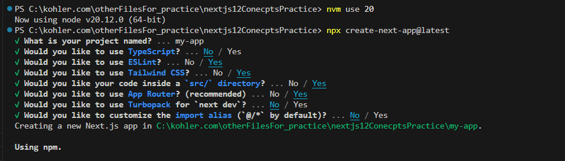

npx create-next-app@latest . (add dot for install project inside your root folder 
                                otherwise it will create folder my-app default inside your folder)

refer scereenshots for basic query after running above command for setup - 
- 

need to use app router 

run project using - npm run dev

<!-- Learn 12 concepts -->

1. Routing and Navigation
    <Link />
2. Metadata
3. Styling (Tailwind css)
4. <Image />
5. Client vs Server Components
    - Data Fetching (Get-requests)
6. Server Actions (POST/PUT/DELETE)
7. Suspense and Streaming
8. Caching
9. Static and dynamic rendering
10. Middleware
11. Production build and deploying
12. 

<!-- Routing and Navigation -->
- src/app/ - Here, you can define all routes of application. 
- pages.tsx file we have for home page by default.
- next.config.js - here we can define all the configs or allow or disallow config or headers.

- reValidatepath("page or url")
- useFormStatus hook from react-dom
    - we can use this for disabling button

- Suspense and Streaming is just used for loading heavy data shows loading...
- ##### **** .next folder will be created when we ran build

